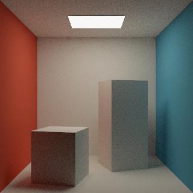

# LUMEN

**Light transport, measured.**

A C++17 path tracer for studying physically based lighting and the cost of rendering it. LUMEN pairs a CPU reference renderer with a CUDA wavefront backend and an OpenGL progressive viewer.



## Rendering

- Triangle and sphere intersections with a flattened, median-split BVH
- Diffuse reflection, ideal mirrors, and dielectric reflection and refraction
- Area-light sampling and cosine-weighted BSDF sampling combined with the power heuristic
- Russian roulette and deterministic per-pixel, per-sample random streams
- Linear floating-point PFM output, display-mapped PPM previews, and CSV timing/error measurements
- Separate CUDA intersection, shading, shadow, and active-path compaction stages

CPU tests and an NVIDIA A100 CUDA execution check pass. Recorded convergence and backend comparisons are in [RESULTS.md](docs/RESULTS.md). The viewer displays progressive CPU renders through OpenGL and does not perform GPU path tracing itself.

## Build and run

Requires CMake 3.24+, a C++17 compiler, and threads. The headless CPU renderer has no third-party runtime dependencies.

```sh
cmake -S . -B build -DCMAKE_BUILD_TYPE=Release
cmake --build build --config Release -j
ctest --test-dir build -C Release --output-on-failure
build/lumen --scene cornell --spp 128 --output renders/cornell
```

For multi-configuration generators, the executable is under `build/Release`. Available scenes are `cornell`, `glass`, and `spheres`. `--help` lists rendering options. PFM files retain linear radiance for comparisons. PPM files apply exposure, Reinhard mapping, and sRGB encoding for display.

Enable CUDA with `-DLUMEN_CUDA=ON` and choose `--backend cuda`. A compatible NVIDIA GPU and CUDA toolkit are required. Set `LUMEN_TEST_GPU=1` when running `lumen_tests` on a GPU to enable the CPU/GPU image check.

Enable the viewer with `-DLUMEN_VIEWER=ON` after installing GLFW 3.3+ and OpenGL development libraries. Run `lumen_viewer glass`. Arrow keys adjust exposure, R resets accumulation, and Escape closes the window. The viewer uses desktop OpenGL compatibility drawing.

## Evaluation

Move the ceiling light with `--light-x OFFSET` between -0.6 and 0.6. To render an animation, install Pillow and run `python tools/animate.py --binary build/lumen`. It saves rendered frames and a lossless WebP loop under `renders/light-motion`.

Animation assembly uses [Pillow](https://python-pillow.github.io/), maintained by Alex Clark and contributors under the HPND license. Pillow packages images rendered by LUMEN.

```sh
python tools/benchmark.py --binary build/lumen --output renders/benchmark
```

The suite compares 8, 32, and 128 samples per pixel against independent 1,024-sample references over three scenes and three seeds. It also compares BVH and brute-force traversal. References retain Monte Carlo error. Timing excludes scene construction and file output. Memory is an explicit buffer-size estimate, not measured peak resident memory. See [methods and limitations](docs/METHODS.md).

## Source map

| Path | Purpose |
| --- | --- |
| `include/lumen/math.h` | Vectors, sampling, random streams, rays, and bounds |
| `include/lumen/scene.h` | Scene representation and shared intersection code |
| `include/lumen/integrator.h` | Shared light transport and material evaluation |
| `include/lumen/render.h` | Rendering and image interfaces |
| `src/scene.cpp` | Procedural scenes and BVH construction |
| `src/render.cpp` | Multithreaded CPU renderer |
| `src/wavefront.cu` | CUDA queues, kernels, and device allocation |
| `src/image.cpp` | PFM, PPM, display mapping, and error computation |
| `src/main.cpp` | Command-line renderer and measurement output |
| `src/viewer.cpp` | Progressive GLFW/OpenGL display |
| `tests/` | Geometry, sampling, determinism, and backend checks |
| `tools/benchmark.py` | Reproducible image-error and throughput runs |
| `tools/animate.py` | Moving-light frames and WebP assembly |
| `docs/` | Methods, results, and references |

## Credits

Created October 24, 2026 by Reego John-Annaselvan. [MIT license](LICENSE). [Change history](CHANGELOG.md).

Rendering methods follow the literature credited in [REFERENCES.md](docs/REFERENCES.md), especially Pharr, Jakob, and Humphreys, and Laine, Karras, and Aila. The Cornell-style scene is procedural and uses no downloaded assets or Cornell measured reflectance data.

The optional viewer uses [GLFW](https://www.glfw.org/), maintained by the GLFW contributors under the zlib/libpng license, and the system OpenGL implementation. The CUDA backend uses NVIDIA's CUDA runtime under NVIDIA's license. CMake, GCC or Clang, clang-format, and Python are build, formatting, and evaluation tools. No external library source is vendored.
